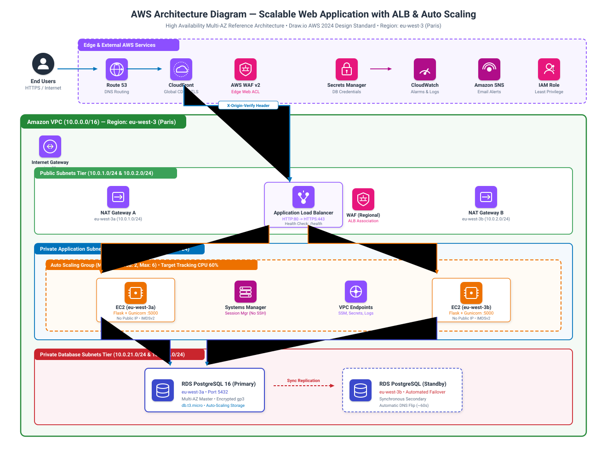
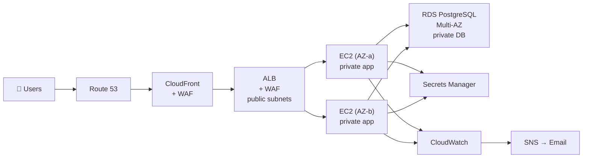

# Scalable Web Application with ALB and Auto Scaling

**AWS Solutions Architect Associate Graduation Project**
**Region:** eu-west-3 (Paris) | **Tech Stack:** Python Flask · PostgreSQL · Terraform · AWS

---

## 📋 Table of Contents

1. [Project Overview](#1-project-overview)
2. [Business Problem](#2-business-problem)
3. [Architecture Overview](#3-architecture-overview)
4. [AWS Services](#4-aws-services)
5. [Network Design](#5-network-design)
6. [Security Architecture](#6-security-architecture)
7. [High Availability & Auto Scaling](#7-high-availability--auto-scaling)
8. [Database Architecture](#8-database-architecture)
9. [Monitoring Strategy](#9-monitoring-strategy)
10. [Quick Start (Local Development)](#10-quick-start-local-development)
11. [Deployment Guide](#11-deployment-guide)
12. [Testing](#12-testing)
13. [Cost Considerations](#13-cost-considerations)
14. [Cleanup](#14-cleanup)
15. [Project Structure](#15-project-structure)
16. [Limitations & Future Improvements](#16-limitations--future-improvements)

---

## 1. Project Overview

This project implements a **production-style, scalable Task Management Web Application** on AWS, demonstrating the core competencies of the AWS Solutions Architect Associate certification.

The application allows users to create, view, update, and delete tasks through a REST API backed by a PostgreSQL database. The infrastructure is designed for high availability, security, automatic scaling, and observability.

| Attribute        | Value |
|------------------|-------|
| Application      | Python Flask + Gunicorn + SQLAlchemy |
| Database         | Amazon RDS PostgreSQL 16 (Multi-AZ) |
| IaC              | Terraform ≥ 1.9 |
| Region           | eu-west-3 (Paris) |
| Availability Zones | 2 (eu-west-3a, eu-west-3b) |
| Load Balancer    | Application Load Balancer |
| Auto Scaling     | Target-tracking (CPU + ALB requests) |
| CDN              | CloudFront |
| WAF              | AWS WAFv2 (Managed Rules) |
| DNS              | Route 53 |
| Access           | SSM Session Manager (no SSH) |

---

## 2. Business Problem

A development team needs to deploy a web application that can:

- **Handle variable traffic** — scale out during peak hours, scale in during off-peak to reduce costs.
- **Survive availability zone failures** — no single point of failure at the compute or database layer.
- **Protect against web attacks** — SQL injection, XSS, rate-limit abuse.
- **Meet security requirements** — no public database exposure, no SSH keys on servers, least-privilege IAM.
- **Provide operational visibility** — alerts when things go wrong, dashboards showing system health.

---

## 3. Architecture Overview

### AWS Architecture Diagram (Draw.io Style)



> 💡 **Interactive Diagram File:** [`architecture/architecture.drawio`](architecture/architecture.drawio) — Open directly at [app.diagrams.net](https://app.diagrams.net) or in VS Code with the Draw.io Integration extension (`hediet.vscode-drawio`).

```
  Users → Route 53 → CloudFront (WAF) → ALB (WAF) → EC2 ASG → RDS PostgreSQL
```



**Traffic flow:**
1. User resolves `tasks.example.com` via Route 53 → CloudFront domain.
2. CloudFront serves from cache or forwards to the ALB (WAF inspects at both layers).
3. ALB health-checks instances and round-robins requests to healthy targets.
4. Flask/Gunicorn processes the request; reads/writes PostgreSQL via SQLAlchemy.
5. CloudWatch collects metrics and logs; alarms trigger SNS email notifications.

---

## 4. AWS Services

| Service | Role | Why |
|---------|------|-----|
| **VPC** | Network isolation | All resources in a private, controlled network |
| **Public Subnets** | ALB, NAT GW | Only ALB and NAT GW need public IPs |
| **Private App Subnets** | EC2 instances | No direct internet access — security |
| **Private DB Subnets** | RDS | Fully isolated from internet and app NACL |
| **Internet Gateway** | Public internet access | ALB needs to receive public traffic |
| **NAT Gateway** | Outbound-only internet for private subnets | Instances need package updates without public IPs |
| **ALB** | Load balancing, health checking | Layer-7 routing, TLS termination, WAF integration |
| **Auto Scaling Group** | Automatic capacity adjustment | Scale with traffic, replace unhealthy instances |
| **Launch Template** | Defines instance configuration | Reproducible, versioned instance setup |
| **EC2** | Application compute | Runs Gunicorn + Flask |
| **RDS PostgreSQL** | Relational database | ACID transactions, Multi-AZ automatic failover |
| **CloudFront** | CDN + TLS + edge caching | Reduced latency, DDoS absorption |
| **WAF** | Web application firewall | OWASP Top 10 protection, rate limiting |
| **Route 53** | DNS | Latency-based or simple routing to CloudFront |
| **ACM** | TLS certificates | Free, auto-renewing HTTPS |
| **IAM** | Access control | Least-privilege roles, no access keys on EC2 |
| **SSM Session Manager** | Secure shell access | No bastion host, no SSH keys, full audit log |
| **Secrets Manager** | Credential storage | DB password stored and retrieved securely |
| **CloudWatch** | Metrics, logs, alarms | Operational visibility |
| **SNS** | Notifications | Email alerts on CloudWatch alarms |

---

## 5. Network Design

```
VPC: 10.0.0.0/16

  PUBLIC SUBNETS (ALB, NAT GW)
  ├── eu-west-3a: 10.0.1.0/24
  └── eu-west-3b: 10.0.2.0/24

  PRIVATE APP SUBNETS (EC2)
  ├── eu-west-3a: 10.0.11.0/24
  └── eu-west-3b: 10.0.12.0/24

  PRIVATE DB SUBNETS (RDS)
  ├── eu-west-3a: 10.0.21.0/24
  └── eu-west-3b: 10.0.22.0/24
```

**Route tables:**
- Public → `0.0.0.0/0` → Internet Gateway
- Private App → `0.0.0.0/0` → NAT Gateway (or none if disabled)
- Private DB → no internet route

**Security Groups (stateful):**
- ALB SG: accepts 80/443 from `0.0.0.0/0`
- App SG: accepts `var.app_port` from ALB SG only
- DB SG: accepts 5432 from App SG only

**NACLs (stateless, subnet-level):** Add an extra defence-in-depth layer, restricting each tier to expected traffic.

---

## 6. Security Architecture

| Control | Implementation |
|---------|---------------|
| No public EC2 IPs | `map_public_ip_on_launch = false` on private subnets |
| No SSH | No key pair on Launch Template; SSM Session Manager only |
| Least-privilege IAM | Custom role: SSM + CloudWatch + scoped Secrets Manager |
| DB isolation | RDS in private DB subnets, SG allows only App SG |
| Credential management | DB password in Secrets Manager; retrieved at boot via IMDSv2 token |
| Encrypted storage | EBS encrypted (gp3), RDS encrypted at rest |
| WAF | OWASP Common, SQL Injection, Bad Inputs rule groups + rate limit |
| IMDSv2 enforced | `http_tokens = "required"`, hop limit = 1 |
| TLS | HTTPS at CloudFront + ALB; ACM certificate |
| No secrets in Git | `.gitignore` excludes `.env`, `*.tfvars`, `*.pem` |

---

## 7. High Availability & Auto Scaling

**Multi-AZ design:**
- ALB spans both AZs — routes around unhealthy targets.
- ASG distributes EC2 instances across both private app subnets.
- RDS Multi-AZ: synchronous replication to standby; automatic failover in ~60s.

**Auto Scaling policies:**
1. **Target tracking — CPU**: scale when average CPU > 60%.
2. **Target tracking — ALB requests**: scale when requests/target > 1000/minute.

**Instance health checking:**
- ASG uses `health_check_type = "ELB"` — replaces instances failing the `/health` endpoint, not just EC2 status checks.

**Rolling deployments:**
- Instance Refresh (`strategy = "Rolling"`, `min_healthy_percentage = 50`) — update Launch Template without downtime.

---

## 8. Database Architecture

**Choice: PostgreSQL 16 on RDS**

- Fully managed — AWS handles patching, backups, monitoring.
- Multi-AZ provides synchronous standby with automatic failover.
- Storage auto-scaling (20 → 100 GiB) prevents out-of-disk incidents.
- Performance Insights (7-day retention, free) helps diagnose slow queries.
- Enhanced monitoring (60s interval) for OS-level metrics.

**Credentials:** Master password stored in Secrets Manager. EC2 instances retrieve it via IAM role at boot — no password in user-data, AMI, or config files.

---

## 9. Monitoring Strategy

**CloudWatch Alarms:**
| Alarm | Threshold | Action |
|-------|-----------|--------|
| EC2 High CPU | > 80% for 10 min | SNS → Email |
| ALB 5xx Errors | > 10 in 5 min | SNS → Email |
| Unhealthy Targets | > 0 for 2 min | SNS → Email |
| RDS High CPU | > 80% for 10 min | SNS → Email |
| RDS Low Storage | < 2 GiB | SNS → Email |

**CloudWatch Dashboard** (`manara-task-app-dev-dashboard`):
- EC2 CPU Utilisation
- ALB Request Count
- ALB Target Response Time
- ALB HTTP 5xx Errors
- RDS CPU Utilisation
- ASG In-Service Instance Count

**Logs:**
- Application logs → `/aws/ec2/{prefix}/application`
- Access logs → `/aws/ec2/{prefix}/access`
- User-data logs → `/aws/ec2/{prefix}/user-data`
- RDS logs → `/aws/rds/instance/{name}/postgresql`

---

## 10. Quick Start (Local Development)

### Prerequisites
- Python 3.12+
- Git

### Steps

```powershell
# 1. Clone the repository
git clone https://github.com/YOUR_USERNAME/manara-aws-project-app.git
cd manara-aws-project-app\application

# 2. Create a virtual environment
python -m venv .venv
.\.venv\Scripts\Activate.ps1

# 3. Install dependencies
pip install -r requirements.txt

# 4. Configure environment
Copy-Item .env.example .env
# Edit .env if needed (defaults use SQLite — no DB server required)

# 5. Run the application
python wsgi.py
# OR
flask --app wsgi run --debug

# 6. Test it
# API: http://localhost:5000/api/tasks
# Health: http://localhost:5000/health
# Info: http://localhost:5000/info
```

### Run Tests
```powershell
cd application
.\.venv\Scripts\Activate.ps1
pytest -v
```

---

## 11. Deployment Guide & CI/CD

> ⚠️ **NEVER run `terraform apply` without reviewing the plan and cost estimate first.**

### Option A: Secure GitHub Actions CI/CD (Recommended)
This repository includes a production-style **Shift-Left Security** CI/CD pipeline:
- **`ci.yml`**: Triggers on pull requests to run **Gitleaks** (secret detection), **Bandit** (Python SAST), **pip-audit** (dependency CVE scanning), **Trivy** (IaC security), and automated **Pytest** (with minimum 80% coverage gate).
- **`deploy.yml`**: Manual workflow dispatch with GitHub Environment approval gates (`production`), architecture profile selector (`Profile A` vs `Profile B`), and automated post-deployment health check probes.

See [documentation/cicd-pipeline.md](documentation/cicd-pipeline.md) for GitHub Secrets and pipeline configuration.

### Option B: Local Terraform CLI
See [documentation/deployment-guide.md](documentation/deployment-guide.md) for the complete manual step-by-step guide.

**Quick reference — Terraform:**
```powershell
cd terraform

# Initialise
terraform init

# Review plan (no changes applied)
terraform plan -var-file="terraform.tfvars"

# Apply (requires explicit approval)
terraform apply -var-file="terraform.tfvars"

# Destroy everything (cleanup)
terraform destroy -var-file="terraform.tfvars"
```

---

## 12. Testing

```powershell
# Unit + API + model tests (no AWS required)
cd application
pytest -v

# With coverage report
pytest --cov=app --cov-report=html

# Skip slow/AWS tests
pytest -m "not slow and not aws"
```

See [documentation/testing-results.md](documentation/testing-results.md) for test execution results.

---

## 13. Cost Considerations

See [documentation/cost-estimation.md](documentation/cost-estimation.md) for a detailed breakdown.

**Profile A (dev/zero-budget):** \$0 — local only, no AWS resources deployed.

**Profile B (full architecture) estimated monthly cost:**
| Resource | ~Monthly Cost |
|----------|--------------|
| ALB | \$18–25 |
| NAT Gateway (2x) | \$65 |
| RDS db.t3.micro Multi-AZ | \$28 |
| EC2 t3.micro × 2 | \$15 |
| CloudFront (< free tier) | \$0 |
| WAF | \$10 |
| **Total** | **~\$136/month** |

---

## 14. Cleanup

```powershell
cd terraform
terraform destroy -var-file="terraform.tfvars"
```

Verify in the AWS Console that the following are removed:
- EC2 instances and Auto Scaling Group
- RDS instance and snapshots
- NAT Gateways and Elastic IPs
- ALB and Target Groups
- CloudFront distribution (may take ~15 minutes)
- VPC and all subnets

---

## 15. Project Structure

```
manara-aws-project-app/
├── README.md
├── .gitignore
├── .gitleaks.toml               ← Shift-Left secret scanning config
│
├── .github/
│   └── workflows/
│       ├── ci.yml               ← Shift-Left security, linting, tests & plan
│       └── deploy.yml           ← CD pipeline with environment approval gates
│
├── application/
│   ├── app/
│   │   ├── __init__.py          ← Application factory
│   │   ├── config.py            ← Environment configurations
│   │   ├── models/
│   │   │   └── task.py          ← Task SQLAlchemy model
│   │   ├── routes/
│   │   │   ├── health.py        ← /health, /info endpoints
│   │   │   └── tasks.py         ← CRUD API endpoints
│   │   └── utils/
│   │       └── metadata.py      ← EC2 IMDSv2 helper
│   ├── tests/
│   │   ├── conftest.py
│   │   ├── test_health.py
│   │   ├── test_tasks.py
│   │   ├── test_models.py
│   │   └── test_config.py
│   ├── wsgi.py                  ← Gunicorn entry point
│   ├── requirements.txt
│   ├── pytest.ini
│   ├── Dockerfile
│   └── .env.example
│
├── terraform/
│   ├── versions.tf
│   ├── providers.tf
│   ├── variables.tf
│   ├── locals.tf
│   ├── vpc.tf
│   ├── subnets.tf
│   ├── internet_gateway.tf
│   ├── nat_gateway.tf
│   ├── route_tables.tf
│   ├── security_groups.tf
│   ├── iam.tf
│   ├── launch_template.tf
│   ├── autoscaling.tf
│   ├── alb.tf
│   ├── rds.tf
│   ├── cloudfront.tf
│   ├── waf.tf
│   ├── route53.tf
│   ├── cloudwatch.tf
│   ├── sns.tf
│   ├── outputs.tf
│   ├── terraform.tfvars.example
│   └── scripts/
│       └── user_data.sh
│
├── architecture/
│   ├── architecture.mmd         ← Mermaid diagram source
│   ├── architecture.svg         ← Draw.io style AWS SVG diagram with service logos
│   └── architecture.drawio      ← Editable Draw.io / diagrams.net XML model
│
└── documentation/
    ├── project-overview.md
    ├── architecture-explanation.md
    ├── network-design.md
    ├── security-design.md
    ├── deployment-guide.md
    ├── cicd-pipeline.md
    ├── cost-estimation.md
    └── testing-results.md
```

---

## 16. Limitations & Future Improvements

| Limitation | Future Improvement |
|------------|-------------------|
| Manual AMI baking | Use HashiCorp Packer or AWS Image Builder |
| Single-region | Add Route 53 latency routing + multi-region replica |
| No caching layer | Add ElastiCache (Redis) for session/query caching |
| Basic WAF rules | Enable Bot Control and Account Takeover Prevention |
| Email-only alerts | Add PagerDuty / Slack integration via SNS |
| No API authentication | Add Amazon Cognito or API Gateway auth |
| SQLite in dev | Add Docker Compose with local PostgreSQL |
