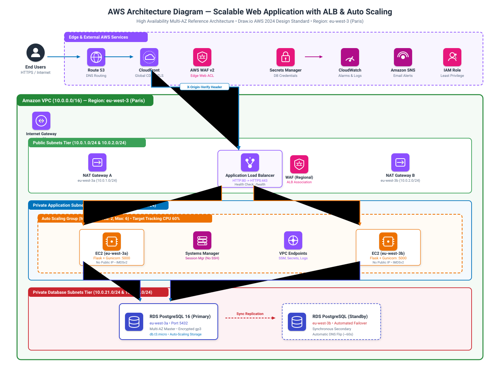

# Architecture Explanation

## Architectural Vision & Rationale

This document provides an in-depth explanation of the architectural decisions, trade-offs, and design patterns employed in the **Scalable Web Application with ALB and Auto Scaling**.

---

## 1. Multi-Tier Layered Architecture

### Visual Architecture Topology (Draw.io AWS Standard)



> 💡 **Editable Source:** [`../architecture/architecture.drawio`](../architecture/architecture.drawio) — Open directly in [app.diagrams.net](https://app.diagrams.net) or in VS Code with the Draw.io extension (`hediet.vscode-drawio`).

The application implements a classic **Three-Tier Architecture** distributed across two Availability Zones (`eu-west-3a` and `eu-west-3b`):

```
       [ Client Request ]
               │
               ▼
   ┌───────────────────────┐
   │ 1. Edge & DNS Tier    │  Route 53 + CloudFront + AWS WAF
   └───────────┬───────────┘
               │
               ▼
   ┌───────────────────────┐
   │ 2. Public Ingress     │  Internet Gateway + ALB + Public Subnets
   └───────────┬───────────┘
               │
               ▼
   ┌───────────────────────┐
   │ 3. Application Tier   │  Auto Scaling Group + EC2 (Stateless Flask)
   └───────────┬───────────┘
               │
               ▼
   ┌───────────────────────┐
   │ 4. Database Tier      │  Amazon RDS PostgreSQL 16 (Multi-AZ)
   └───────────────────────┘
```

---

## 2. Component Breakdown & Engineering Decisions

### 2.1 Amazon Route 53 & Amazon CloudFront
- **Role:** Global DNS resolution and edge content acceleration.
- **Decision:** Even though the Flask app serves dynamic REST endpoints, placing CloudFront in front of the Application Load Balancer provides:
  1. **DDoS Protection via AWS Shield Standard:** Volumetric attacks are absorbed at AWS edge locations before reaching the VPC.
  2. **Global TLS Termination:** Reduces TCP handshake latency for distributed clients.
  3. **WAF Edge Inspection:** Malicious requests (SQLi, bad bots) are filtered at the edge rather than consuming ALB bandwidth.
- **Origin Shielding:** A custom secret header (`X-Origin-Verify`) is injected by CloudFront and verified at the ALB/WAF level, preventing attackers from bypassing CloudFront and targeting the ALB IP directly.

### 2.2 AWS WAFv2 (Web Application Firewall)
- **Role:** Layer 7 application protection.
- **Two-Layer Enforcement:**
  - **Global Web ACL (CloudFront):** Inspects incoming edge traffic.
  - **Regional Web ACL (ALB):** Acts as secondary defense in depth.
- **Managed Rule Groups:**
  - `AWSManagedRulesCommonRuleSet` (OWASP Top 10 vulnerabilities).
  - `AWSManagedRulesKnownBadInputsRuleSet` (Malformed headers, exploits).
  - `AWSManagedRulesSQLiRuleSet` (SQL injection signatures).
  - `RateLimitRule` (Limits individual IPs to 2000 requests per 5 minutes to mitigate brute-force and application DDoS).

### 2.3 Application Load Balancer (ALB)
- **Role:** Distributes inbound HTTP/HTTPS traffic to backend EC2 instances across AZs.
- **Key Configurations:**
  - **Cross-Zone Load Balancing:** Enabled by default on ALBs, ensuring an equal distribution of traffic across all target instances regardless of which AZ receives the DNS request.
  - **Target Group Health Checking:** Performs automated polling of the Flask `/health` endpoint every 30 seconds.
  - **Connection Draining (Deregistration Delay):** Configured to 30 seconds to allow inflight requests to complete gracefully before terminating or replacing instances during scale-in operations.
  - **HTTP to HTTPS Redirection:** Automatically enforces TLS compliance on incoming port 80 traffic.

### 2.4 Compute Tier: EC2 & Auto Scaling Group
- **Stateless Application Model:** The Flask application does not store sessions, files, or state on local disk. Everything is persisted in Amazon RDS. This allows any instance to be replaced or terminated at any second without user impact.
- **EC2 Launch Template:**
  - Uses the modern **Amazon Linux 2023** AMI.
  - **IMDSv2 Enforced:** `http_tokens = "required"` and `http_put_response_hop_limit = 1` eliminate SSRF (Server-Side Request Forgery) attacks targeting the Instance Metadata Service.
  - **Encrypted EBS:** Root volumes use AWS-managed KMS key encryption (`gp3`).
  - **Zero Key Pairs:** No EC2 Key Pair (`.pem`) is created. All interactive access occurs through IAM-governed AWS Systems Manager Session Manager.
- **Target Tracking Scaling Policies:**
  - **CPU-Based Scaling:** Targets 60% average CPU utilization across instances.
  - **Request-Count-Based Scaling:** Scales proactively based on ALB requests per target (threshold: 1,000 requests/target/minute), protecting the system during rapid traffic surges before CPU spikes occur.

### 2.5 Database Tier: Amazon RDS PostgreSQL Multi-AZ
- **Engine:** PostgreSQL 16.3 on `db.t3.micro` (or scalable to `db.m6g.large` in production).
- **Multi-AZ Architecture:**
  - Primary instance resides in `eu-west-3a` (Private DB Subnet).
  - Synchronous standby replica continuously replicated in `eu-west-3b`.
  - **Automated Failover:** If the primary fails, RDS updates DNS records to point to the standby within 60 to 120 seconds with zero manual intervention and zero data loss.
- **Storage Autoscaling:** Base storage of 20 GiB dynamically scales up to 100 GiB as table volume expands.
- **Isolation:** Placed in dedicated subnets with zero internet access. Inbound traffic is accepted exclusively on port 5432 from the Application Security Group.

### 2.6 Operations & Observability
- **AWS Secrets Manager:** Automatically holds the database master credentials. At boot, the instance fetches credentials using its IAM role and IMDSv2 session token.
- **CloudWatch Agent:** Installed via User Data script, streaming both system-level logs (`/var/log/taskmanager/app.log`, access logs, and user-data logs) and memory/disk metrics to CloudWatch.
- **Amazon SNS:** Connects to CloudWatch Alarms to send instant email alerts for high CPU, ALB 5xx spikes, or RDS storage exhaustion.
