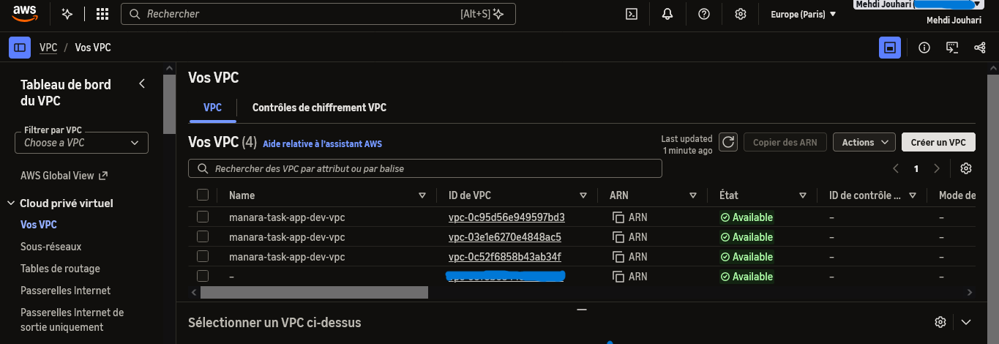
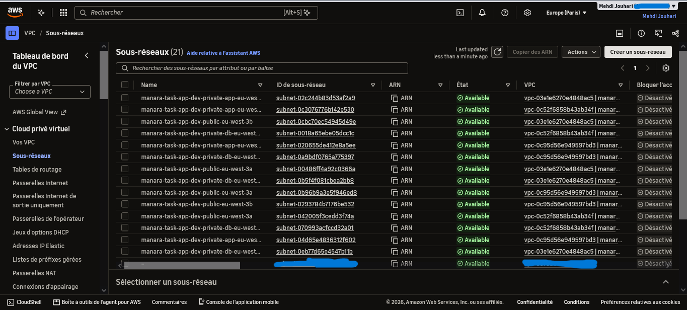
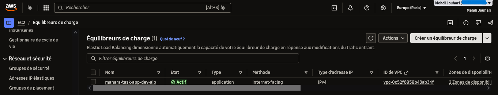
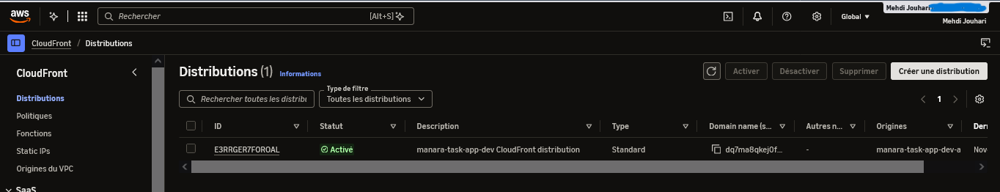
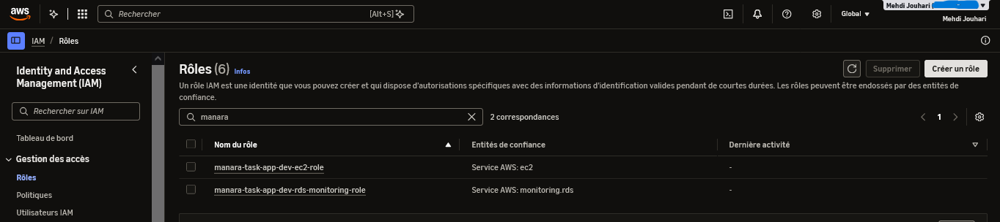
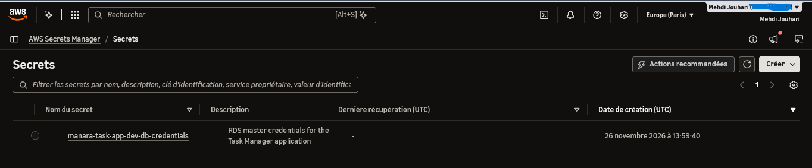
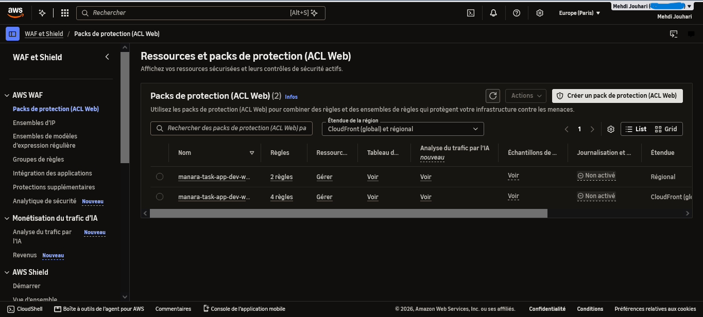
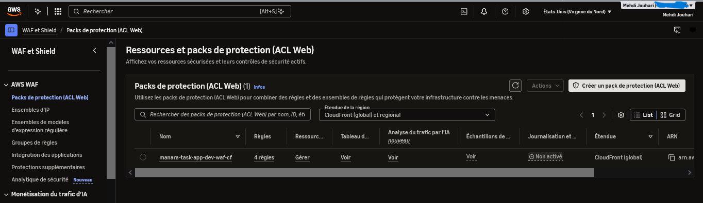
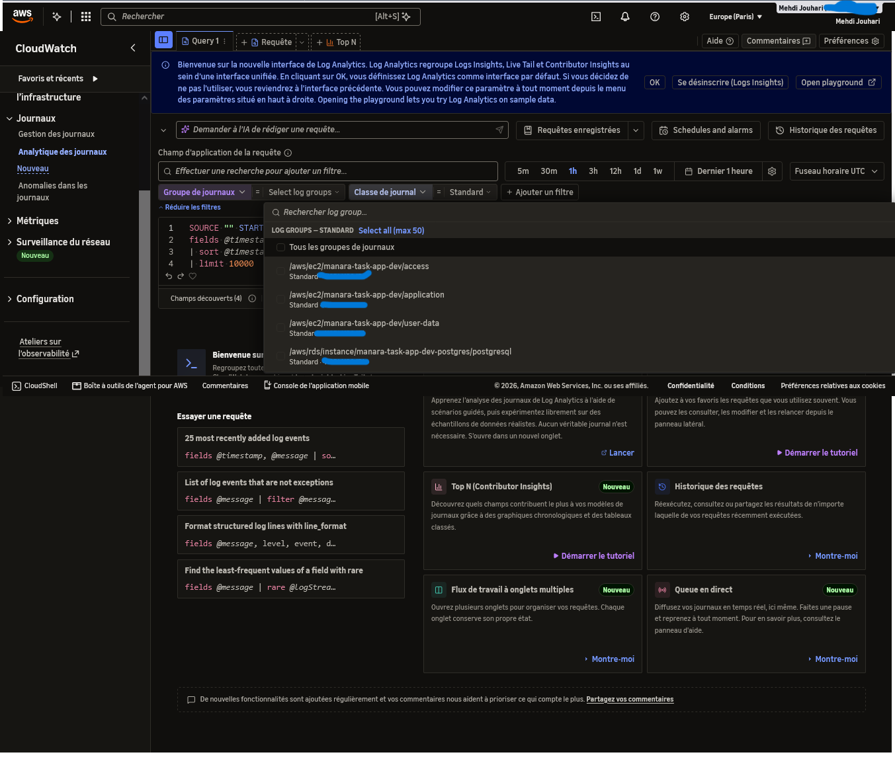

# AWS Deployment Evidence

This gallery organizes AWS Console screenshots captured on **2026-11-26**. They show resources visible in the AWS account at that time; they are evidence of resource presence, not proof of successful application behavior. See [Testing Results](testing-results.md) for what is and is not verified.

## VPC and Networking

VPC inventory — eu-west-3

Subnet inventory — eu-west-3

## Traffic and Edge Services

Application Load Balancer — eu-west-3

CloudFront distribution — global

## Identity and Security

IAM roles — global

Secrets Manager — eu-west-3

Regional WAF ACLs — eu-west-3

Global WAF ACL — us-east-1

## Observability

CloudWatch Logs — eu-west-3

