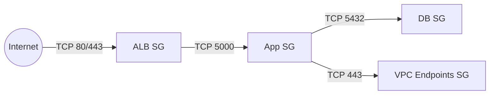

# Network Design & Topology

## 1. VPC CIDR Allocation & Subnetting Plan

The network architecture is built inside a dedicated Amazon Virtual Private Cloud (VPC) in `eu-west-3` with a primary CIDR block of `10.0.0.0/16` (65,536 private IPv4 addresses).

To ensure high availability, the VPC is partitioned across two Availability Zones (`eu-west-3a` and `eu-west-3b`) with three dedicated subnet tiers in each zone.

### Subnet Layout Table

| Tier | Subnet Name | AZ | CIDR Block | Usable IPs | Route Destination | Public IP on Launch |
| :--- | :--- | :--- | :--- | :--- | :--- | :--- |
| **Public** | `public-eu-west-3a` | `eu-west-3a` | `10.0.1.0/24` | 251 | Internet Gateway (`igw-*`) | **Yes** |
| **Public** | `public-eu-west-3b` | `eu-west-3b` | `10.0.2.0/24` | 251 | Internet Gateway (`igw-*`) | **Yes** |
| **Private App** | `private-app-eu-west-3a` | `eu-west-3a` | `10.0.11.0/24` | 251 | NAT Gateway A / Endpoints | **No** |
| **Private App** | `private-app-eu-west-3b` | `eu-west-3b` | `10.0.12.0/24` | 251 | NAT Gateway B / Endpoints | **No** |
| **Private DB** | `private-db-eu-west-3a` | `eu-west-3a` | `10.0.21.0/24` | 251 | Local VPC Only | **No** |
| **Private DB** | `private-db-eu-west-3b` | `eu-west-3b` | `10.0.22.0/24` | 251 | Local VPC Only | **No** |

*(Note: AWS reserves 5 IP addresses per subnet for internal network management.)*

---

## 2. Gateways and Routing Strategy

```
                           [ INTERNET ]
                                │
                      ┌─────────┴─────────┐
                      │  Internet Gateway │
                      └─────────┬─────────┘
                                │
        ┌───────────────────────┴───────────────────────┐
        ▼                                               ▼
[ Public Subnet AZ-A ]                         [ Public Subnet AZ-B ]
 ├─ ALB Node                                    ├─ ALB Node
 └─ NAT Gateway A                               └─ NAT Gateway B
        │                                               │
        ▼ (Default Route 0.0.0.0/0)                     ▼ (Default Route 0.0.0.0/0)
[ Private App Subnet AZ-A ]                    [ Private App Subnet AZ-B ]
 └─ EC2 Flask Instances                         └─ EC2 Flask Instances
        │                                               │
        └───────────────────────┬───────────────────────┘
                                │ (Local Route 10.0.0.0/16 Only)
                                ▼
                   [ Private DB Subnets (A & B) ]
                    └─ RDS PostgreSQL Multi-AZ
```

### Route Table Configurations

1. **Public Route Table (`rt-public`):**
   - Associated with: `10.0.1.0/24`, `10.0.2.0/24`
   - `10.0.0.0/16` → `local`
   - `0.0.0.0/0` → `Internet Gateway (igw-*)`

2. **Private Application Route Tables (`rt-private-app-a`, `rt-private-app-b`):**
   - Associated with respective Private App subnets.
   - `10.0.0.0/16` → `local`
   - **Profile B:** `0.0.0.0/0` → respective NAT Gateway (`nat-*`) in the same AZ to avoid inter-AZ latency and data transfer charges.
   - **Profile A (Zero Budget):** NAT Gateways omitted; outbound communication to AWS APIs is served via AWS PrivateLink VPC Interface Endpoints.

3. **Private Database Route Table (`rt-private-db`):**
   - Associated with: `10.0.21.0/24`, `10.0.22.0/24`
   - `10.0.0.0/16` → `local`
   - **No outbound internet routes.** Database nodes are completely air-gapped from external networks.

---

## 3. Firewall Boundaries: Security Groups vs. Network ACLs

The network enforces defense-in-depth through two distinct firewall mechanisms:

### 3.1 Stateful Security Groups (Instance/ENI Level)



- **ALB Security Group (`sg-alb`):**
  - Ingress: TCP 80 and TCP 443 from `0.0.0.0/0`
  - Egress: All traffic allowed to VPC destinations
- **Application Security Group (`sg-app`):**
  - Ingress: TCP 5000 restricted **only** to references of `sg-alb`
  - Egress: Outbound traffic allowed (to RDS port 5432 and AWS services)
- **Database Security Group (`sg-db`):**
  - Ingress: TCP 5432 restricted **only** to references of `sg-app`
  - Egress: No outbound rules allowed
- **VPC Endpoints Security Group (`sg-vpc-endpoints`):**
  - Ingress: TCP 443 from `sg-app`
  - Egress: All outbound allowed to VPC

### 3.2 Stateless Network ACLs (Subnet Level)

Unlike security groups, Network ACLs are stateless; return traffic must be explicitly allowed via ephemeral ports (TCP 1024–65535).

1. **Public Subnet NACL:**
   - Ingress Rules: Allow TCP 80/443 from `0.0.0.0/0`, allow ephemeral ports (1024-65535) for NAT return traffic.
   - Egress Rules: Allow all outbound.
2. **Private App Subnet NACL:**
   - Ingress Rules: Allow TCP 5000 from `10.0.0.0/16`, allow ephemeral ports from `0.0.0.0/0`.
   - Egress Rules: Allow all outbound (for software package retrieval and DB communication).
3. **Private DB Subnet NACL:**
   - Ingress Rules: Allow TCP 5432 from `10.0.0.0/16`.
   - Egress Rules: Allow ephemeral return traffic back to `10.0.0.0/16`.

---

## 4. End-to-End Traffic Walkthroughs

### Scenario A: Inbound Task Creation (`POST /api/tasks`)
1. User client executes HTTPS POST request to domain name.
2. Amazon Route 53 resolves domain alias to CloudFront Anycast IP address.
3. CloudFront Edge Location terminates client TLS, validates request with AWS WAF, and forwards via AWS backbone network to ALB public IP.
4. ALB receives request on port 443, evaluates Regional WAF rules, and performs round-robin load-balancing to forward traffic on TCP port 5000 to an EC2 instance in `eu-west-3a`.
5. Gunicorn routes request to Flask application worker.
6. Flask handles validation, constructs SQL INSERT query, and connects over TCP 5432 to the RDS PostgreSQL Primary endpoint.
7. RDS executes transaction, synchronously replicates changes to standby replica in `eu-west-3b`, and returns confirmation.
8. Flask returns JSON payload (HTTP 201 Created) back through ALB to CloudFront to Client.

### Scenario B: SSM Session Manager Shell Access (Zero SSH)
1. System Administrator issues command: `aws ssm start-session --target <instance-id>`
2. AWS Systems Manager service initiates WebSocket connection to the SSM Agent running inside EC2.
3. Outbound connection from EC2 reaches AWS Systems Manager endpoint via VPC Interface Endpoint (or NAT Gateway).
4. Interactive shell session opens directly in administrator's terminal over secure TLS without requiring an open port 22 or public IP on the EC2 instance.
